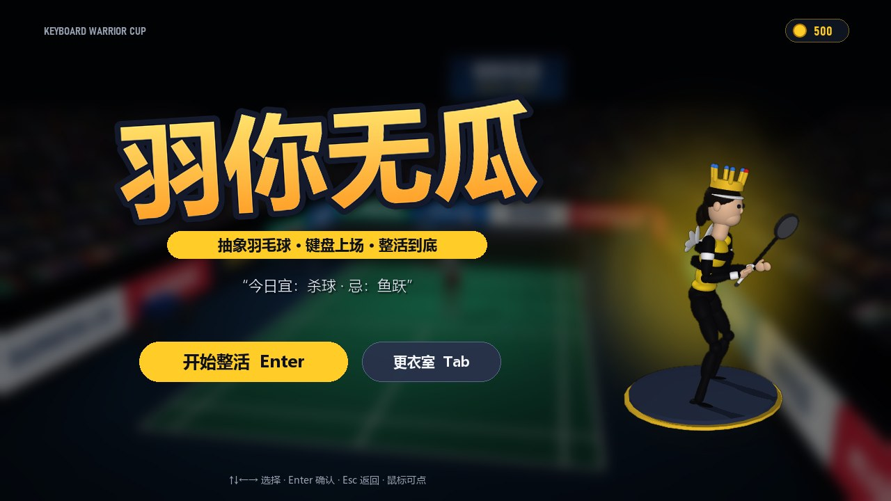

# Badminton Retargeting

A keyboard-controlled badminton simulator built with MuJoCo. The game models shuttle drag, turnover, and racket contact, then blends retargeted motion clips with procedural footwork and inverse kinematics. Play a quick match, campaign, ladder, or training drill. Ladder opponents use shot selection learned through self-play.



## Play

```bash
python -m pip install -r requirements.txt
python scripts/play.py
python scripts/play.py --mode training --drill smash
```

Use the arrows or WASD to aim, J for a soft shot, K for a high shot, L for a power shot, and Space to jump. Press P to pause or Q to quit. The game uses the supplied processed stroke library and works with keyboard input.

## Motion and self-play

- `badrt/` contains the simulator, movement controller, opponent tactics, and game UI.
- `scripts/retarget_video.py` maps MediaPipe landmarks to the simulated character with Laplacian retargeting and sequential quadratic programming. Install `requirements-retargeting.txt` and supply your own footage and MediaPipe Task models in `assets/models/` for the offline video pipeline.
- `scripts/build_library.py` cuts retargeted motion into reusable stroke segments. `assets/` contains the game-ready stroke library and learned tactics.
- `python scripts/train_selfplay.py --gens 12` trains shot selection and writes `assets/brain.npz`. `python scripts/eval_brain.py` evaluates saved generations against scripted tactics.

Source videos, model downloads, recordings, and local profiles are kept outside this repository. Tests that use recorded footage require those fixtures separately.
